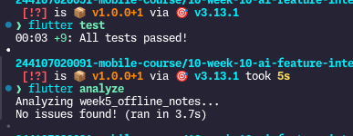
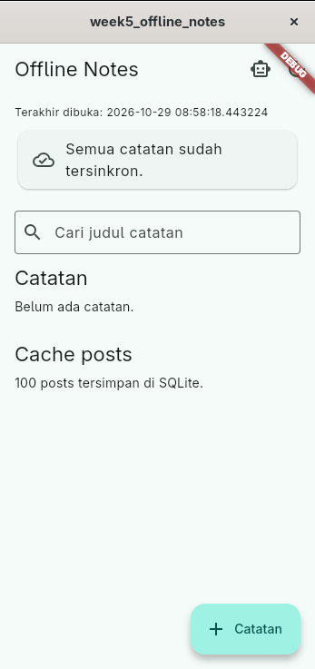
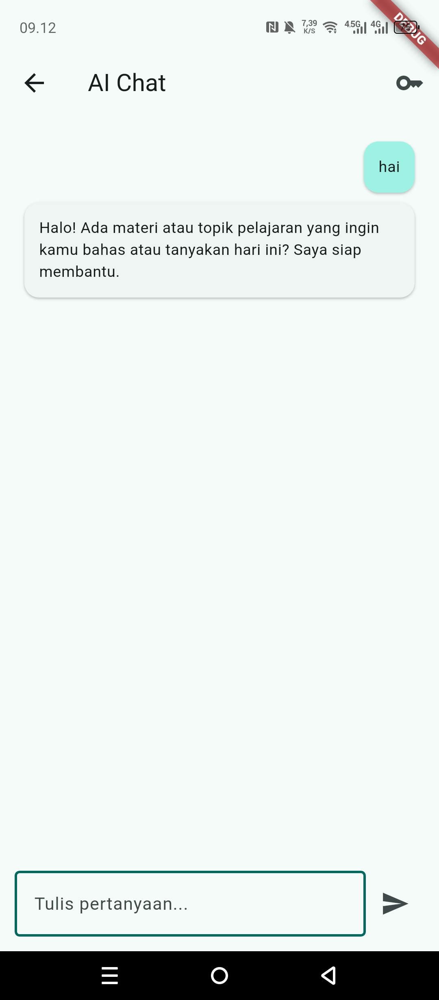

# Week 10 — AI Feature Integration

**Nama:** Najla Nuricia Laudy

**Kelas:** TI-3F

**NIM:** 244107020091

## Bukti mesin hijau

Validasi dijalankan dari folder `week5_offline_notes`:

## Risiko dan mitigasi

| Risiko | Dampak | Mitigasi |
|---|---|---|
| Prompt atau catatan pribadi terkirim ke penyedia AI | Kebocoran privasi | Jangan kirim data sensitif; system prompt melarang permintaan data pribadi; API key disimpan di secure storage |
| API key terekspos di repository atau log | Penyalahgunaan akun dan biaya | Key dimasukkan saat runtime, tidak di-hardcode, dan tidak dicatat dalam `docs/ai-log.md` |
| Prompt injection atau jawaban tidak akurat | Keputusan pengguna keliru | Batasi penggunaan untuk bantuan belajar, tampilkan respons sebagai teks yang perlu diverifikasi, dan gunakan system prompt yang eksplisit |
| Pemakaian API berlebihan | Biaya tidak terkendali | Gunakan model ringan, kirim pertanyaan seperlunya, pantau kuota provider, dan tambahkan batas penggunaan sebelum produksi |

### Refleksi

1\. Fitur AI: ai chat menggunakan gemini API

2\. Privasi pengguna: Tidak meminta data pribadi, dan API key disimpan menggunakan `FlutterSecureStorage`.

3\. Fallback: Menampilkan pesan error jika API gagal dipanggil, sehingga pengguna tahu bahwa fitur AI sedang bermasalah.

4\. Pelajaran UX: Fitur AI di mobile harus mudah digunakan, responsif, dan memberikan pesan yang jelas saat sedang memproses atau mengalami error.