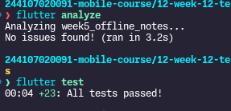

# Week 12 — Testing Quality Assurance
**Nama:** Najla Nuricia Laudy

**Kelas:** TI-3F

**NIM:** 244107020091

Project utama yang diuji: **Offline Notes** (`week5_offline_notes`) — catatan lokal (SQLite + sync) + cache posts + AI chat.

## Skenario Pengujian

1. **Logika (unit)**: aturan bisnis / validasi.
   - `group NoteModel` (fromMap field hilang, dirty flag).
   - `group filterNotesByTitle` (case‑insensitive, query kosong → semua, tidak cocok → empty state).
2. **Dependensi**: akses data lewat repository + fake (sukses & error).
   - `group NoteRepository via FakeNoteRepository` (fetch/add/update/delete/markAllSynced/countDirty).
   - `group syncNotes` (sukses menandai tersinkron, tanpa dirty → 0, error).
3. **UI (widget)**: tampilan awal, input tidak valid, aksi sukses, state error.
   - Empty state, catatan dari fake, invalid input (judul kosong), save sukses → tampil di list, error state (`Gagal membaca catatan`).
4. **Alur utama (integrasi)**: tambah catatan via UI → catatan tampil di daftar.

## Hasil

- `flutter test` → **27/27 passed**
- `flutter test integration_test/app_test.dart -d linux` → **1/1 passed** (device: `linux`)
- `flutter analyze` → **No issues found**

Command integration test: `flutter test integration_test/app_test.dart -d linux`

## Temuan Belum Terselesaikan

- Widget test error state memakai fake (`throwError`), bukan DB real.
- Fitur chat/AI belum diuji.
- Update/hapus catatan lewat UI belum diuji (hanya lewat repository/fake).
- Pengujian hanya berjalan di Linux desktop

## Refleksi

## Pertanyaan Terkait

1. **Bug terlewat terbesar tanpa pengujian:** race `TextEditingController` dipakai setelah dispose di dialog tambah/edit. Tanpa test alur save, exception ini lolos dan menampai kegagalan render ulang setelah pop.
2. **Bagian yang perlu fake:** data access (repository/DB) lewat `FakeNoteRepository`. Membuat pengujian konsisten karena deterministik, cepat, tidak butuh SQLite/device.
3. **Perbedaan hasil widget vs integration:** widget memakai fake (nilai tetap), integration memakai DB real + device (nilai bervariasi, perlu bersih tabel `notes` tiap run).
