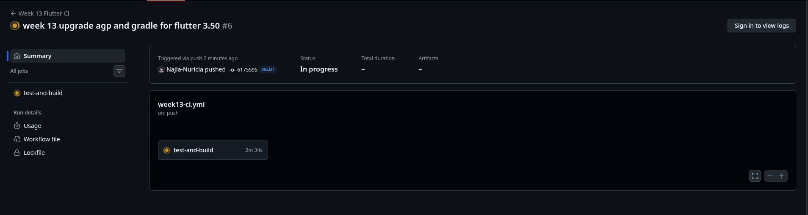
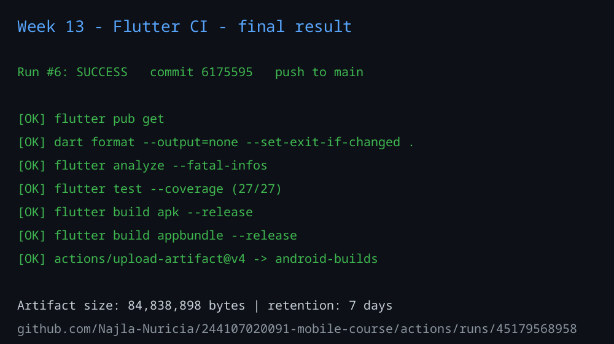

# Minggu 13 — CI/CD Automation

**Nama:** Najla Nuricia Laudy  
**Kelas:** TI-3F  
**NIM:** 244107020091

Project yang dipakai: [`week5_offline_notes`](./week5_offline_notes/) (Offline Notes — catatan lokal SQLite + sinkronisasi + cache posts + AI chat).

## Alur CI/CD

`commit / pull request` → checkout → siapkan Flutter → `pub get` → format → analyze → test → build Android → simpan artefak.

Workflow aktif: [`.github/workflows/week13-ci.yml`](../../.github/workflows/week13-ci.yml) di root repository. GitHub Actions hanya membaca workflow dari root, jadi file ini memakai `paths` filter untuk folder minggu 13 dan `working-directory` ke project. Salinan sesuai instruksi codelab ada di [`./.github/workflows/flutter-ci.yml`](./.github/workflows/flutter-ci.yml).

- Trigger: `push` dan `pull_request` ke `main` (hanya perubahan di `13-week-13-ci-cd-automation/**` dan file workflow), plus `workflow_dispatch`.
- Permission minimum: `contents: read`.
- `concurrency` dengan `cancel-in-progress: true` agar run lama dibatalkan saat ada push baru.

## Pemeriksaan yang dijalankan

| Step | Perintah | Hasil lokal |
| --- | --- | --- |
| Dependensi | `flutter pub get` | PASS: |
| Format | `dart format --output=none --set-exit-if-changed .` | PASS: 34 file, 0 berubah |
| Analisis | `flutter analyze --fatal-infos` | PASS: No issues found |
| Test | `flutter test --coverage` | PASS: 27/27 passed |
| APK | `flutter build apk --release` | PASS: 59,0 MB |
| AAB | `flutter build appbundle --release` | PASS: 57,8 MB |
| Artefak | `actions/upload-artifact@v4` | `android-builds`, `retention-days: 7`, `if-no-files-found: error` |

Bukti: [log verifikasi lokal](./docs/ci-local-run.log) · [riwayat kegagalan dan perbaikannya](./docs/ci-run-1-failure-and-fix.md) ·  · 

Run akhir: [Week 13 Flutter CI #6](https://github.com/Najla-Nuricia/244107020091-mobile-course/actions/runs/45179568958) — commit `6175595`, event `push` ke `main`, status **success**. Semua step lolos (format, analyze, test, build APK, build AAB, upload artefak). Artefak `android-builds` berukuran 84,8 MB dan tersimpan 7 hari. Run #1-#2 gagal di analyze karena depresiasi `material.dart` pada Flutter 3.50; run #3-#4 dibatalkan oleh concurrency; run #5 gagal di build karena AGP/Gradle lama. Semua sudah diperbaiki tanpa menonaktifkan pemeriksaan. Artefak berisi:

- `build/app/outputs/flutter-apk/app-release.apk` — untuk instalasi/uji internal;
- `build/app/outputs/bundle/release/app-release.aab` — format distribusi Google Play.

Build sukses **tidak** berarti siap publish: signing, konfigurasi, izin, dan pengujian perangkat tetap perlu ditinjau. Workflow ini tidak mengunggah ke Play Store.

## Versioning

- Sebelum: `1.0.0+1`
- Sekarang: `1.0.1+2` — patch karena tidak ada perubahan perilaku aplikasi, hanya pipeline CI/CD; build number naik untuk setiap unggahan baru.
- Versi berikutnya: `1.1.0+3` bila ada fitur baru yang kompatibel, atau `1.0.2+3` bila hanya perbaikan. Tag rilis `v1.0.1` sebaiknya dibuat dari commit yang sudah lolos CI.

## Keamanan dan risiko yang masih perlu ditangani

- Token/password/material signing hanya lewat GitHub Actions Secrets, tidak di source. Workflow ini sudah `contents: read`; PR dari fork tidak mendapat secrets repository.
- Nilai `--dart-define` dapat diekstrak dari aplikasi klien → jangan dipakai untuk credential. URL API/env adalah konfigurasi publik, bukan secret.
- Build rilis belum bertanda tangan. Keystore produksi jangan disimpan di repo atau workflow pull request; siapkan workflow rilis terpisah yang membatasi akses dan menginjeksi material sensitif dari Secrets.
- Artefak tersimpan 7 hari dan dapat diunduh oleh siapa pun yang punya akses repository → batasi akses dan hapus setelah tidak diperlukan.
- Tetap perlu approval/manual review sebelum rilis: signing, izin Android, konfigurasi API, dan uji pada perangkat nyata.
- Jangan mencetak secret ke log atau meneruskannya ke proses yang tidak dipercaya.

## Refleksi

- Otomatisasi menangkap regresi format, error analisis statis, test gagal, dan kegagalan build Android sebelum perubahan di-merge.
- Untuk menyelidiki build gagal, dibutuhkan nomor run, commit/SHA, log step yang gagal, versi Flutter/SDK, dan artefak/log Gradle.
- Bagian yang masih butuh pemeriksaan manual: signing keystore, konfigurasi API, izin, pengujian perangkat, dan keputusan rilis/Play Store.
