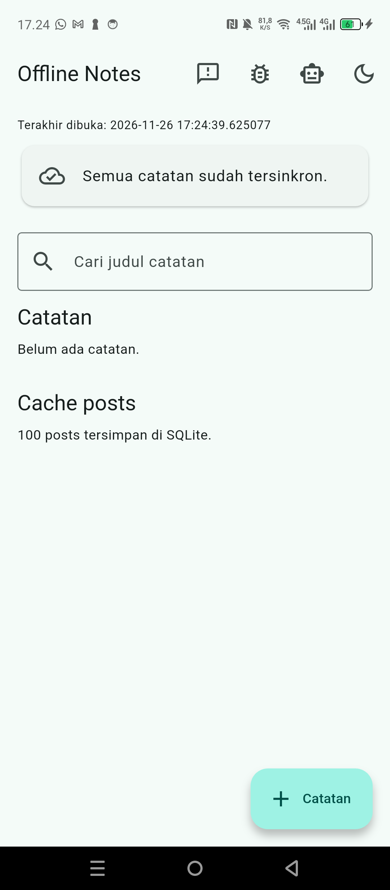
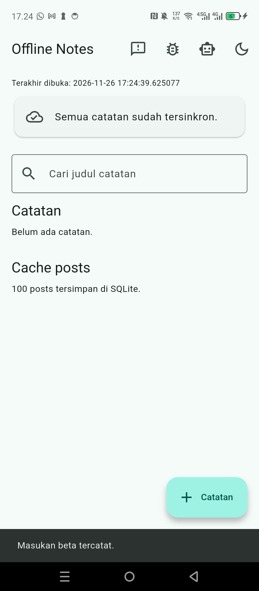
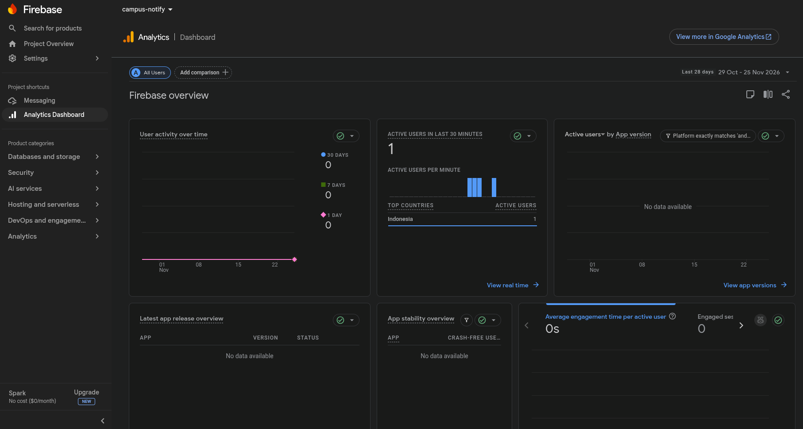

# Minggu 14 — Deployment dan Monitoring

**Nama:** Najla Nuricia Laudy
**Kelas:** TI-3F
**NIM:** 244107020091

Project: [`week5_offline_notes`](./week5_offline_notes/), salinan project minggu 13 yang sudah lolos CI.

## Ringkasan kandidat

| Item | Nilai |
| --- | --- |
| Kandidat | beta-1 |
| Versi / build | 1.1.0 / 4 |
| Commit / tag | `f1aa2f5` / `v1.1.0-beta1` |
| AAB | 59.889.468 bytes, SHA-256 `02d19fd0…c62caf` |
| APK terdistribusi | 60.083.676 bytes, SHA-256 `36a704b5…d94d7ba` |
| Distribusi | Firebase App Distribution, grup `beta-testers`, release `0u0b3pgpdqn58` |
| Perangkat uji | Infinix X6882, Android 14 |
| Telemetry | Crashlytics terverifikasi di dashboard; event `beta_feedback_sent` dipicu di perangkat |

Laporan lengkap: [`docs/release-report.md`](./docs/release-report.md). Bukti pendukung ada di [`docs/`](./docs/).

## Yang dikerjakan

- Versi dinaikkan ke `1.1.0+4`; commit dibersihkan dan diberi tag `v1.1.0-beta1` sehingga AAB/APK dapat dipetakan ke satu SHA Git.
- Signing rilis memakai keystore di luar repository lewat `android/key.properties` yang di-ignore Git. Pipeline tanpa key tetap memakai fallback debug agar CI minggu 13 tidak rusak.
- `lib/monitoring.dart` menginisialisasi Firebase, memasang `FlutterError.onError` dan `PlatformDispatcher.instance.onError` ke Crashlytics, menyediakan probe non-fatal, dan mengirim event Analytics `beta_feedback_sent` dengan parameter tetap `screen_name=home`.
- Tombol probe beta hanya dikompilasi dengan `--dart-define=ENABLE_BETA_PROBE=true`; build produksi tidak memilikinya.
- Pemeriksaan `pub get`, format, `analyze --fatal-infos`, 27 test, build AAB, dan build APK seluruhnya lulus.
- APK rilis diunggah ke Firebase App Distribution dan **benar-benar dipasang serta diuji** pada perangkat Android fisik. Unggahan AAB ditolak karena project belum terhubung ke Play Console; keterbatasan ini dicatat di laporan.
- Error non-fatal buatan muncul di dashboard Crashlytics dengan versi `1.1.0`. Event Analytics dipicu di perangkat; pembacaan balik GA4 tidak memungkinkan dengan scope kredensial yang tersedia dan tidak diklaim.

## Bukti uji di perangkat

Screenshot diambil dari Infinix X6882 (Android 14) setelah memasang biner hasil unduhan Firebase App Distribution.

  
  
  

1. **Beranda** — daftar catatan, status sinkronisasi, dan tombol uji monitoring (hanya ada di build beta).
2. **Kirim masukan** — snackbar `Masukan beta tercatat.` menandakan event `beta_feedback_sent` dikirim.
3. **Probe Crashlytics** — snackbar `Probe Crashlytics terkirim.`; laporan non-fatal kemudian muncul di dashboard Crashlytics dengan issue `ca417bae60a4992ebabfd1cfc530011f`.

### Dashboard Analytics

Dashboard Firebase Analytics menunjukkan **1 active user dalam 30 menit terakhir** dengan aktivitas dari Indonesia. Ini membuktikan data telemetry sampai ke layanan Analytics; verifikasi per-event `beta_feedback_sent` lewat GA4 API tetap memerlukan scope `analytics.readonly` seperti dijelaskan di laporan.

## Keputusan

Beta internal **dilanjutkan**, perluasan produksi **ditahan** sampai AAB terdistribusi lewat Play Console, jumlah tester bertambah, dan event Analytics terverifikasi di dashboard GA4.

## Keamanan

- Tidak ada token, password keystore, email tester, ID perangkat lengkap, atau data pribadi yang ditulis ke repository.
- `google-services.json` dan `firebase_options.dart` berisi konfigurasi publik Firebase, bukan credential rahasia.
- Event Analytics hanya memuat `screen_name=home`; probe Crashlytics memakai alasan tetap `monitoring_probe`.
